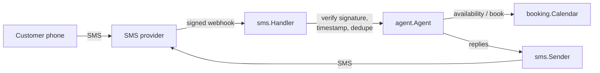

# SMS Booking Agent

A small Go service that books appointments over text message. A customer texts a number, the agent collects their name and request, offers open times, and confirms the booking. It's all done over SMS.

This repo is a **standalone demo** of the patterns I use in production SMS booking systems. It runs offline with no accounts, API keys, or database.

```
you   > hi
agent > Hi! Thanks for texting Demo Studio. I can book you a consultation. What's your name?
you   > Sam
agent > Nice to meet you, Sam! In a sentence or two, what would you like to get done?
you   > A small consultation
agent > Here are the next open times:
        1) Tue Oct 27 at 11:00 AM
        2) Tue Oct 27 at 2:00 PM
        3) Tue Oct 27 at 5:00 PM
        Reply with 1-3.
you   > 1
agent > Book Tue Oct 27 at 11:00 AM? Reply YES to confirm or NO to see other times.
you   > yes
agent > You're booked for Tue Oct 27 at 11:00 AM. Confirmation BK-0001. See you then, Sam!
```

## How it works



| Package | Responsibility |
|---|---|
| `internal/sms` | Webhook endpoint. Verifies HMAC signatures, rejects replays outside a 5-minute window, de-duplicates retried deliveries, caps body size. |
| `internal/agent` | Conversation engine. One state machine per phone number. Handles carrier-required keywords (STOP, START, HELP) before anything else. |
| `internal/booking` | Calendar. Concurrency-safe booking: when two people confirm the same slot, exactly one wins and the other is offered fresh times. |

## Design notes

- **Security first.** Every request is authenticated with HMAC-SHA256 over `timestamp.body`, compared in constant time. Stale timestamps are rejected to stop replay attacks, and the secret comes only from the environment. The server refuses to start without one.
- **Idempotent webhooks.** SMS providers retry when a response is slow. The handler records message IDs so a retried message never advances the conversation twice.
- **Messaging compliance.** STOP opts the number out immediately, and the agent goes silent until START. HELP always works and never disrupts an in-progress booking.
- **Race-safe booking.** `Calendar.Book` mirrors what a database unique constraint gives you in production. A test fires 50 concurrent bookings at one slot and asserts exactly one succeeds.
- **LLM-ready.** The agent is a deterministic state machine so it's testable and runs offline. In production an LLM sits behind the same `Responder` interface, using availability and booking as its tools, while state tracking like this keeps it on task.

## Run it

Requires Go 1.22+.

```bash
# Chat with the agent in your terminal
go run ./cmd/chat

# Run the tests (with the race detector)
go test -race ./...
```

### Run the webhook server

```bash
cp .env.example .env              # then set WEBHOOK_SECRET
export WEBHOOK_SECRET=$(openssl rand -hex 32)
go run ./cmd/server

# In another terminal, send a signed test message
curl -X POST localhost:8080/webhooks/sms \
  $(go run ./cmd/sign testdata/inbound.json | xargs) \
  --data-binary @testdata/inbound.json
```

Replies are logged to the console. Swap `sms.LogSender` for a real provider client to send actual texts.

## License

MIT
